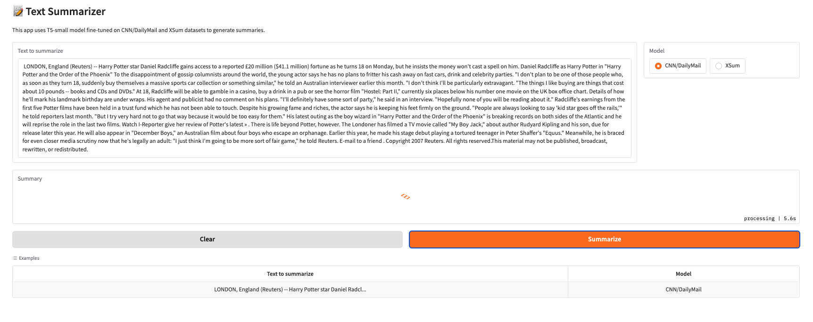
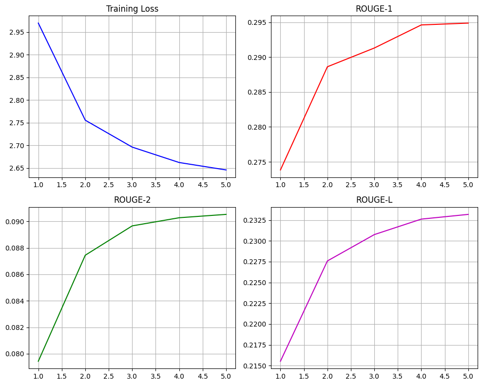
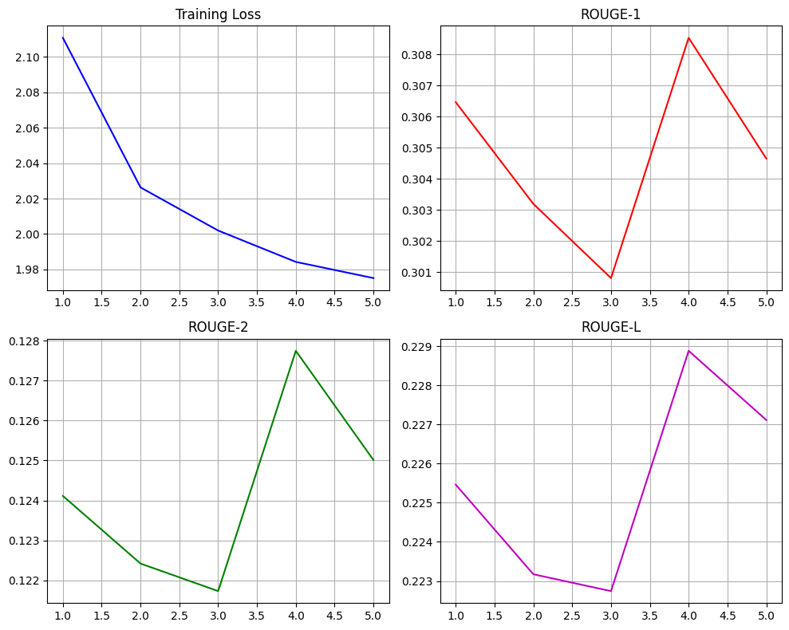

# Text Summarizer

An experimental text summarization project that fine-tunes pretrained T5-small separately on subsets of CNN/DailyMail and XSum, with saved training histories and a Gradio interface.



## Quick Start

Complete the [installation](#installation) first. The web interface loads both
`models/cnn_dailymail_epoch_5.pth` and `models/xsum_epoch_5.pth` at startup. These
checkpoints are not included in the repository; generate them by fine-tuning or
provide compatible local checkpoints before launching the app.

```bash
# Fine-tune pretrained T5-small on both datasets (downloads data and model weights)
poetry run python -m src.main

# Run the web interface after both epoch-5 checkpoints exist
poetry run python -m src.app.app
```

Fine-tuning can take substantial time. Review the defaults below before starting.

## Saved Results

The values below are the final (epoch 5) entries in the checked-in
[CNN/DailyMail history](results/cnn_dailymail_training_history.json) and
[XSum history](results/xsum_training_history.json), multiplied by 100 and rounded
to one decimal place. The training code computes ROUGE on the validation subset
after each epoch. These are archived validation results, not a fresh reproduction
or a full test-set benchmark.

The histories contain loss and ROUGE values but no seed, checkpoint identifier,
code revision, or full run configuration. The defaults documented below describe
the current code and cannot establish the exact configuration of those saved runs.

### CNN/DailyMail (5 epochs)

- **ROUGE-1**: 30.5%
- **ROUGE-2**: 12.5%
- **ROUGE-L**: 22.7%

### XSum (5 epochs)

- **ROUGE-1**: 29.5%
- **ROUGE-2**: 9.1%
- **ROUGE-L**: 23.3%

## Features

- **Two Fine-Tuning Targets**: Separate CNN/DailyMail and XSum checkpoints
- **Web Interface**: Gradio UI with model selection and an example input
- **Device Selection**: MPS when available, otherwise CPU; CUDA is not selected by the current code

## Learning Curves

### XSum Progress



### CNN/DailyMail Progress



## Example Outputs

These illustrative outputs are retained from the original README. Their inputs
and references appear in [`src/test.py`](src/test.py), but the displayed predictions
are not linked to a saved checkpoint or run record. Separate generated examples
are stored in [`results/xsum_examples.json`](results/xsum_examples.json) and
[`results/cnn_dailymail_examples.json`](results/cnn_dailymail_examples.json).

### XSum Example

**Input:** The full cost of damage in Newton Stewart, one of the areas worst affected, is still being assessed. Repair work is ongoing in Hawick and many roads in Peeblesshire remain badly affected by standing water...

**Reference:** Clean-up operations are continuing across the Scottish Borders and Dumfries and Galloway after flooding caused by Storm Frank.

**Model:** A flood warning has been put in place across the Scottish Borders due to flooding in Dumfries and Galloway.

### CNN/DailyMail Example

**Input:** LONDON, England (Reuters) -- Harry Potter star Daniel Radcliffe gains access to a reported £20 million ($41.1 million) fortune as he turns 18 on Monday, but he insists the money won't cast a spell on him...

**Reference:** Harry Potter star Daniel Radcliffe gets £20M fortune as he turns 18 Monday . Young actor says he has no plans to fritter his cash away . Radcliffe's earnings from first five Potter films have been held in trust fund .

**Model:** Daniel Radcliffe says he has no plans to fritter his cash away on fast cars, drink and celebrity parties. At 18, he will be able to gamble in a casino, buy a drink in a pub or see the horror film "Hostel: Part II" Radcliffe's earnings from the first five Potter films have been held in a trust fund.

## Project Structure

```
t5-text-summarization-cnn-dailymail/
├── README.md
├── pyproject.toml        # Dependencies
└── src/
    ├── model/model.py    # T5 Model
    ├── data/dataio.py    # Data Loading
    ├── train/train.py    # Training Loop
    ├── utils/utils.py    # ROUGE Metrics
    ├── app/app.py        # Gradio interface (requires local checkpoints)
    ├── test.py           # Prints summaries for fixed example inputs
    └── main.py           # Entry Point
```

## Installation

### Prerequisites

- Python 3.9+
- Poetry

### Setup

```bash
git clone https://github.com/00200200/t5-text-summarization-cnn-dailymail

cd t5-text-summarization-cnn-dailymail
poetry install
```

## Training and Example Checks

```bash
# Fine-tune on XSum only
poetry run python -m src.main xsum

# Fine-tune on CNN/DailyMail only
poetry run python -m src.main cnn

# Fine-tune on both datasets
poetry run python -m src.main

# Print example summaries using both local epoch-5 checkpoints
poetry run python -m src.test
```

`src.test` prints reference and generated summaries; it does not run assertions or
compute aggregate test-set metrics. Training saves checkpoints under `models/`
and writes histories, examples, and plots under `results/`.

## Model Configuration

- **Base Model**: Pretrained `t5-small`, loaded with `from_pretrained`
- **Max Input Length**: 512 tokens
- **Target Tokenization Limit**: 128 tokens
- **Generation Limit**: 150 tokens, with 4-beam search
- **Learning Rate**: 5e-5
- **Optimizer**: AdamW
- **Device**: MPS/CPU
- **Default Epochs**: 5

## Training Details

- **Training Size**: First 30,000 entries of each training split; shuffled by the data loader
- **Validation Size**: First 1,000 entries of each validation split
- **Batch Size**: 16
- **Scheduler**: Linear with 500 warmup steps
- **Evaluation**: After each epoch

These defaults are defined in [`src/main.py`](src/main.py),
[`src/data/dataio.py`](src/data/dataio.py), and [`src/train/train.py`](src/train/train.py).
Validation references are decoded from targets truncated to 128 tokens. The code
does not set a random seed or record a full experiment configuration.

## Web Interface

The Gradio interface allows you to:

- Choose between CNN/DailyMail and XSum models
- Enter text and generate a summary (input is truncated to 512 tokens)
- Switch checkpoints to inspect their outputs on the same input

### Running the Interface

```bash
poetry run python -m src.app.app
```

Run this from the repository root after both checkpoint files are available.
Open the local URL printed by Gradio; the application calls `demo.launch()` without
fixing a port. Generation time depends on the device and input, and generated
summaries may omit or invent details.

### Features

- Text input
- Model selection (CNN/DailyMail or XSum)
- An example input
- Clear button
- Summary generation using the selected checkpoint

### Models

- **CNN/DailyMail**: Checkpoint fine-tuned on article/highlights pairs
- **XSum**: Checkpoint fine-tuned on document/summary pairs

Both use the same generation settings; summary length and sentence count are not guaranteed.
